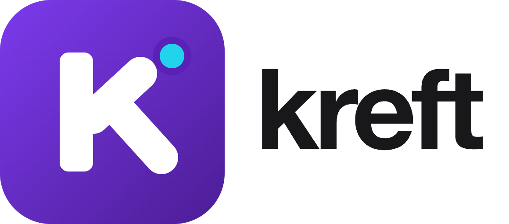

<p align="center"></p>

# Kreft

**A small reactive framework with its own component language, and a full Node.js backend to go with it.**

You write components in `.kreft` files in plain words: `state`, `derive`, `action`. The same project also gives you routing, controllers, an Active Record ORM, migrations, queues, mail, sign-in pages with two-factor codes, and a development server with hot reload that keeps your state.

🌐 **[kreftjs.com](https://kreftjs.com)** · 📖 **[Read the documentation](docs/README.md)** ([online](https://kreftjs.com/docs)) · run `npm run dev` and open `/demo/docs` for the searchable version.

```html
<!-- Counter.kreft -->
state count = 0
derive double = count * 2
action add() { count++ }

<view>
  <button @click={add}>{count} × 2 = {double}</button>
</view>
```

## Start in a minute

You need [Node.js](https://nodejs.org) 22.5 or newer.

```bash
npm install -g kreftjs@latest   # once: makes the `kreft` command available everywhere
kreft new my-app        # asks: JavaScript or TypeScript?
cd my-app
npm run dev
```

Open the address in the terminal (normally `http://localhost:8000`). A new project already has sign-in, registration, password reset, a dashboard and a profile page. The development database has a test user, **test@example.com** with the password **password**, for local use only.

## What is inside

| | |
|---|---|
| **The `.kreft` language** | `state`, `derive`, `action`, `watch`, `prop`, `event`, slots, stores, `saved` data, `load` for APIs, forms with validation, animations. |
| **Router** | Nested routes, layouts, guards, error pages, clean URLs. |
| **Backend** | `Route`, controllers, form requests, policies, models with relations, soft deletes and scopes, migrations, seeders, factories, jobs, mail, notifications, cache, Redis, file storage, scheduling. |
| **Authentication** | Cookie sessions with CSRF protection, API tokens with permissions, device list, two-factor codes, email verification, account lockout. |
| **Phone apps** | iOS and Android apps with Capacitor: `kreft new my-app --mobile`, one command to run on an emulator, a layout whose top and bottom bars never move, 42 phone components, native features (device, files, haptics, share, position), touch events, an animated splash screen, app icons. |
| **Tooling** | `kreft dev` with hot reload, DevTools, an error monitor, `kreft build` (CSP-safe), prerendering, TypeScript, Vite, Electron, Tauri and HarmonyOS support, a safer `kreft add`, an MCP server for AI agents. |

## Put it online

```bash
npm install kreftjs@latest       # the newest version
npm run build                    # the finished site, ready to upload
```

Upload what is inside the output folder (`dist/`; for this repository's own website, `dist/kreftjs-com`) to your host. The kreftjs.com steps, and releasing a new package version with `npm publish`, are in [Publish the website](docs/README.md#publish-the-website-kreftjscom).

## Platforms

One project, every screen. The pages are the same `.kreft` files; each target adds a native shell.

| Target | Systems | How | Status |
|---|---|---|---|
| Web | any browser | `kreft new my-app` | Tested |
| Desktop | macOS, Linux, Windows | Electron or Tauri: `kreft add electron`, `kreft add tauri` | macOS tested; Linux and Windows not tested here |
| Mobile | iOS, Android | Capacitor: `kreft new my-app --mobile` | Android tested; iOS not tested here |
| Mobile | HarmonyOS | ArkTS web view: `kreft new my-app --harmony` | Not tested here |
| TV | Android TV, tvOS, webOS, Tizen | | **Coming soon** (not available yet) |

*Tested* means Kreft's own tests ran it for real. *Not tested here* means the same code is meant to run there but Kreft has not run it: build and check it on that system before you ship. Which to choose, what each needs and the TV plan: [Platforms](docs/README.md#one-codebase-every-screen).

## Desktop apps (Electron)

```bash
kreft new my-app --electron      # or: kreft electron:init in an existing app
npm install
kreft electron                   # opens the app in its own window (no browser, no URL)
```

Make installers (build each system on that system; `.deb` and `.rpm` need Linux):

```bash
npm run electron:build:mac     # .dmg and .zip
npm run electron:build:win     # NSIS installer and portable .exe
npm run electron:build:linux   # AppImage, .deb and .rpm
npm run electron:build:all     # all three (same as: kreft electron:build --all)
```

The app icon is `build/icon.png`. Every setting (window, menu, DevTools, security, tray, updates, installers) is in one file, `config/electron.config.js`, which `kreft add electron` writes. The menu is hidden and DevTools are off in the installed app by default. Details: [Desktop apps with Electron](docs/README.md#desktop-apps-with-electron) and [Desktop configuration](docs/README.md#desktop-configuration).

## Desktop apps (Tauri)

Smaller installers than Electron: Tauri uses the web view the system already has. It needs [Rust](https://rustup.rs).

```bash
kreft new my-app --tauri         # or: kreft tauri:init in an existing app
npm install
kreft tauri                      # opens the app in its own window (no browser, no URL)
kreft tauri:build                # installers for the system you are on, in src-tauri/target/release/bundle/
```

Options for `tauri:build`: `--debug`, `--bundles dmg|app|nsis|msi|deb|rpm|appimage`, `--target <rust-triple>`. The first build compiles Rust and takes a few minutes. Settings are in `config/tauri.config.js` (`kreft add tauri` writes it); Electron and Tauri can be installed in the same project. Details: [Desktop apps with Tauri](docs/README.md#desktop-apps-with-tauri) and [Desktop configuration](docs/README.md#desktop-configuration).

## HarmonyOS apps (Huawei)

```bash
kreft new my-app --harmony       # or: kreft harmony:init in an existing app
cd my-app
kreft harmony:build --api-url https://your-server.example
kreft harmony:open               # opens harmony/ in DevEco Studio; press Run
```

The app is a small ArkTS shell with one full-screen web view that loads your built site from its own files. It needs [DevEco Studio](https://developer.huawei.com/consumer/en/deveco-studio/). The generated project follows the DevEco template for HarmonyOS NEXT (API 12) but has not been run on a device yet. Details: [HarmonyOS apps](docs/README.md#harmonyos-apps).

## Phone apps (iOS and Android)

```bash
kreft new my-app --mobile        # or: kreft mobile:init in an existing app
cd my-app
npm install
kreft mobile:run --android       # builds, installs and starts the app on an emulator or phone
```

`kreft mobile:dev` adds live reload and does the first-run setup (`APP_KEY`, storage link, migrations). Android needs Android Studio and a Java from 21 to 23 (the commands find one by themselves); iOS needs a Mac with Xcode. Details, every component and the native API: [Mobile apps](docs/README.md#mobile-apps-ios-and-android).

Ready for the stores? One command makes the signed files: `kreft mobile:release --android` (`.apk` and `.aab`), `--ios` (`.ipa`), `--harmony` (`.hap` and `.app`); `--dry-run` shows every step first. Signing, version numbers and a checklist: [Publishing your app](docs/README.md#publishing-your-app-to-google-play-and-the-app-store).

## Learn more

| I want to… | Read |
|---|---|
| Learn Kreft in Arabic, from basics to advanced tested examples | [كتاب Kreft بالعربية](book/ar/README.md) |
| Build my first page | [Your first app](docs/README.md#your-first-app) and [Components](docs/README.md#components-and-the-kreft-file) |
| Fetch data and handle forms | [Fetching data](docs/README.md#fetching-data), [Forms](docs/README.md#forms-and-validation) |
| Add an API and a database | [Routing](docs/README.md#routing), [Models](docs/README.md#models-and-the-database), [Migrations](docs/README.md#migrations-seeders-and-factories) |
| Understand sign-in | [Authentication](docs/README.md#authentication) |
| Go to production | [Build and deploy](docs/README.md#build-and-deploy), [Production checklist](docs/README.md#production-checklist) |
| Look up a command | [Command line](docs/README.md#command-line), then `kreft list` |

## The demo

In this repository, `npm run dev` serves live examples of every feature at **http://localhost:8000/demo/**: components, forms, loops, animations, the router and layouts, a database page, the backend, and the searchable documentation at `/demo/docs`.

## Repository layout

```text
kreftjs.js, kreftjs.d.ts  the browser runtime and its TypeScript types
server.js, server.d.ts    the backend entry point: require('kreftjs/server')
bin/                      the `kreft` command and the backend modules (bin/backend/)
tools/                    hot reload client, DevTools, Vite plugin
templates/app/            the project that `kreft new` creates
editors/                  editor plugins for .kreft files, with Emmet: vscode (also Antigravity, Cursor),
                          sublime, zed, jetbrains, vim. Install one with `kreft editor <name>`
demo/                     the interactive demo
docs/                     the manual (README.md) and its viewer (Docs.kreft)
test/                     security regression tests: npm test
```

## Security

Package installs use a staged npm dependency review, configurable advisory and license policies, integrity verification, and JSON/text reports. See [Package security](docs/package-security.md) for configuration, CI usage, and current limitations.

Views are escaped, logins use HttpOnly cookies with CSRF protection, passwords use scrypt, and `kreft dev` only answers your own computer. The manual has a [Security overview](docs/README.md#security-overview) and a [Production checklist](docs/README.md#production-checklist). Run `npm test` to run the security regression tests.

## License

Kreft is released under the [Elastic License 2.0](LICENSE). You may use it, including to build and sell your own applications, copy it and change it. You may not offer Kreft itself to others as a hosted or managed service, and you may not remove or hide its license notices.
